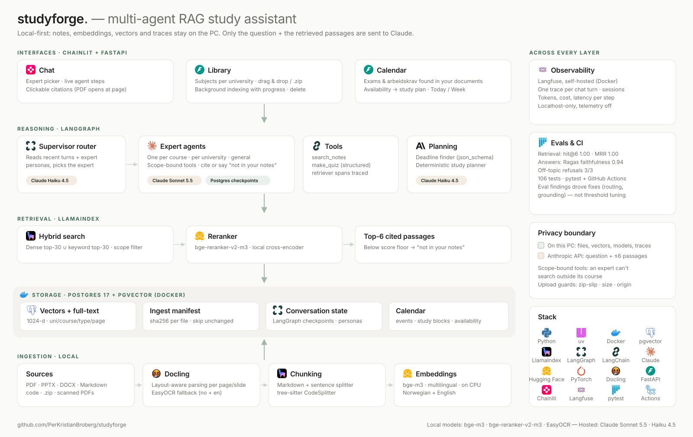

# studyforge



Local-first, multi-agent RAG study assistant for studying at two universities at once (UiB + NHH).
Each course gets its own expert agent that answers only from that course's notes, with clickable citations.

- **Chat** — a Haiku router picks the right course expert (LangGraph); experts search with hybrid
  dense + keyword retrieval (LlamaIndex, Postgres + pgvector), rerank locally, and answer with Claude Sonnet.
- **Library** (`/library`) — subjects and files per university, uploads (incl. zip), background indexing with live status.
- **Calendar** (`/calendar`) — finds exams and arbeidskrav in your documents as confirmable suggestions,
  then plans study blocks around your weekly availability (deterministic planner, no LLM).

Embeddings (bge-m3), reranking (bge-reranker-v2-m3), parsing (Docling), OCR (EasyOCR) and tracing (Langfuse)
all run locally; only the model calls go to Anthropic. Full walkthrough: [docs/how-it-works.md](docs/how-it-works.md).

## Run

```bash
cp .env.example .env          # add ANTHROPIC_API_KEY
docker compose up -d --wait   # Postgres + pgvector on 127.0.0.1:5433
uv sync
uv run --env-file .env chainlit run src/studyforge/ui.py --host 127.0.0.1 --port 8000
```

Open http://127.0.0.1:8000 — chat at `/`, then `/library` and `/calendar`. Models warm up in the background at startup.

Course files go in `notes/<uni>/<course>/...` (gitignored — never committed). Subfolders named `exams/`, `code/`,
`admin/` set the document type; files directly under `notes/<uni>/` or in `notes/<uni>/admin/` belong to the whole
institution. Upload through the Library page, or index from the CLI:

```bash
uv run ingest                                         # incremental, resumable per file
uv run ask "What is NPV?" --uni NHH --course BED3E
uv run --env-file .env chat                           # terminal chat, auto-routes to the best expert
uv run --env-file .env chat --expert NHH/BED3E        # talk to one expert
```

## Test

```bash
uv run pytest                    # unit + integration (integration needs Postgres running)
uv run pytest -m eval evals -s   # retrieval quality (Ragas) on samples/ (downloads models)
```

## Tracing (optional, local only)

`docker compose --env-file .env -f infra/langfuse/docker-compose.yml up -d`, then open http://127.0.0.1:3000.
The `LANGFUSE_INIT_*` values in `.env` create the org, project, API keys and login on first start. Each chat turn is
one `chat-turn` trace (session = conversation), with `route-question`, `retrieve-notes` and `generate-quiz` steps.

## Not built yet

An MCP server over the same backend is in the [design spec](docs/superpowers/specs/2026-09-29-studyforge-design.md)
but deliberately deferred; so is Google Calendar sync.
