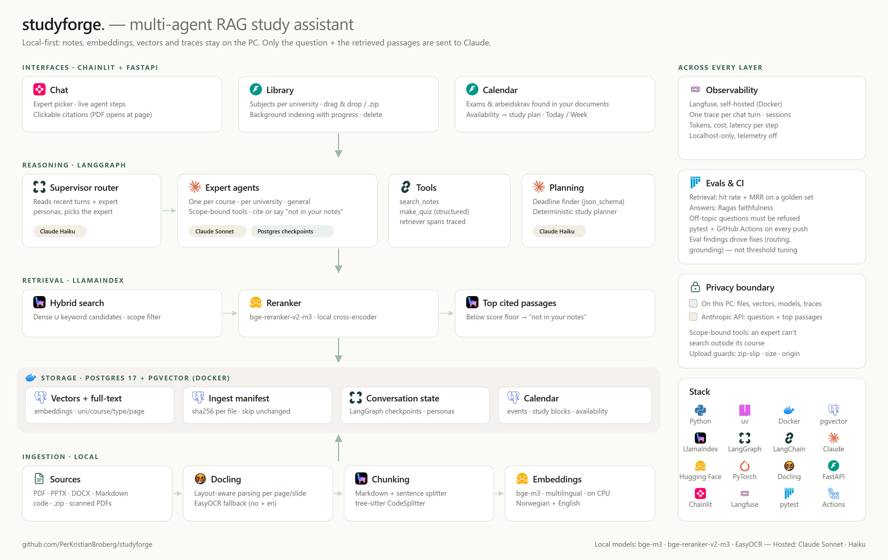
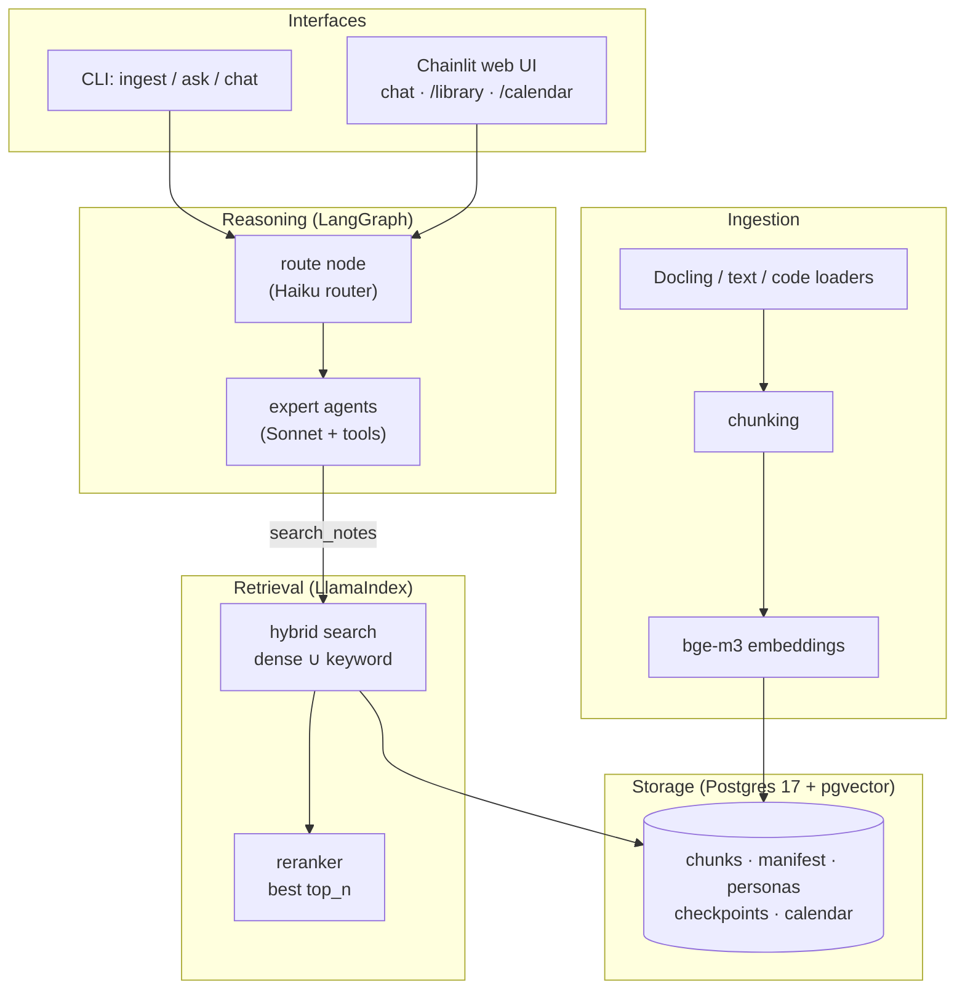
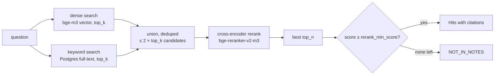
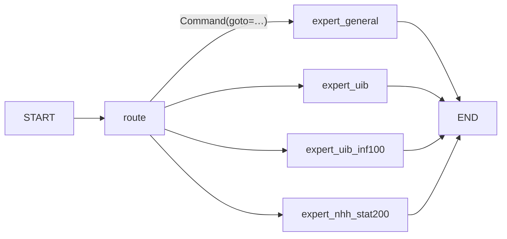

# How studyforge works

A detailed walkthrough of what happens inside studyforge, from a file landing in `notes/` to a cited answer
in the chat and a study plan in the calendar. File references point at `src/studyforge/` unless stated otherwise.

Tunable values (how many passages, thresholds, chunk sizes, limits, model versions) are deliberately **not**
repeated here, so this guide doesn't go stale: they live in `config.Settings` (section 12) or as named constants
in the module this guide points to.



---

## 1. The big picture

studyforge is a **local-first, multi-agent RAG (retrieval-augmented generation) study assistant** for a student
who studies at more than one university at the same time. You give it your course material (slides, PDFs,
notes, code, old exams); it gives you:

- **Chat** — ask questions and get answers written *only* from your own notes, with clickable citations.
  Each course gets its own "expert" agent that can only search that course's material.
- **Library** — a page for managing subjects and files (upload, zip upload, delete) with background indexing.
- **Calendar** — finds exams and *arbeidskrav* (mandatory assignments) in your documents, lets you confirm
  them, and plans study blocks around your weekly availability.

Everything runs on your PC except the language model calls to Claude (Anthropic API):

| Runs locally | Runs at Anthropic |
|---|---|
| Your files, parsing (Docling), OCR (EasyOCR) | Answer generation (Claude Sonnet, `expert_model`) |
| Embeddings (bge-m3) and reranking (bge-reranker-v2-m3) | Routing, personas, deadline finding (Claude Haiku, `router_model`); quiz (Sonnet) |
| Postgres + pgvector (vectors, chat history, calendar) | |
| Langfuse tracing (optional, self-hosted) | |

The system has five layers, and the rest of this document follows them bottom-up:



---

## 2. Running it

| What | Command | Where |
|---|---|---|
| Database | `docker compose up -d --wait` | Postgres on `127.0.0.1:5433` |
| Dependencies | `uv sync` | CPU-only PyTorch from the PyTorch index |
| Index your notes | `uv run ingest [notes_dir]` | default `notes/` |
| Search without an LLM | `uv run ask "What is a p-value?" --uni NHH --course STAT200` | prints reranked passages |
| Terminal chat | `uv run --env-file .env chat [--expert UiB/INF100] [--thread id]` | needs `ANTHROPIC_API_KEY` |
| Web UI | `uv run --env-file .env chainlit run src/studyforge/ui.py --host 127.0.0.1` | http://127.0.0.1:8000 |
| Tracing (optional) | `docker compose --env-file .env -f infra/langfuse/docker-compose.yml up -d` | http://127.0.0.1:3000 |

The three console scripts are declared in `pyproject.toml`: `ingest` → `ingest.main`, `ask` → `retrieval.main`,
`chat` → `app.main`.

---

## 3. How your files are organised

studyforge does not use a database of "courses". **The folder structure is the data model.** Everything lives
under `notes/` (gitignored, never committed):

```
notes/
├── UiB/                         ← university ("uni")
│   ├── regulations.pdf          ← uni-level file (no course)
│   ├── admin/                   ← uni-level, doc_type = admin
│   │   └── exam-rules.md
│   └── INF100/                  ← course
│       ├── lecture-01.pptx      ← doc_type = notes
│       ├── linked-lists.md
│       ├── exams/2025-exam.pdf  ← doc_type = exams
│       └── code/Stack.java      ← doc_type = code
└── NHH/
    └── STAT200/...
```

`paths.classify()` turns a path into `FileMeta(path, uni, course, doc_type)`:

- **uni** = first folder under `notes/`. A file directly in `notes/` (no uni folder) is ignored.
- **course** = second folder, *unless* that folder is a document-type folder (`exams`, `code`, `data`, `admin`),
  in which case the file belongs to the whole university (`course = None`).
- **doc_type** = the first document-type folder anywhere in the path; otherwise `code` for source files and
  `notes` for everything else.
- Hidden files/folders (`.git`, `.obsidian`) and Office lock files (`~$...`) are skipped.

**Supported file types** (`paths.py`):

| Kind | Extensions | Loader |
|---|---|---|
| Documents | `.pdf`, `.pptx`, `.docx` | Docling (layout-aware), EasyOCR fallback for scanned PDFs |
| Text | `.md`, `.txt` | read as UTF-8; Obsidian `[[wikilinks]]` flattened to plain text |
| Code | `.py .java .js .ts .c .h .cpp .cs .go .rs .r .sql` | read as text, tagged with its language |

The same course code can exist at two universities, so a course is always identified as `uni/course`
(e.g. `UiB/INF100`). `retrieval.Scope` enforces this: a course scope without a uni raises an error.

---

## 4. Ingestion: from files to vectors

Entry point: `ingest.run(root, settings, embed=None, progress=None)` → returns a `Report`
(`new / updated / unchanged / removed / failed`).

### 4.1 Incremental sync with a manifest

Parsing and embedding are slow (seconds per PDF on CPU), so ingestion is **incremental**. The
`ingest_manifest` table (`store.Manifest`) stores, per file:

```
path (PK) │ sha (sha256 of file bytes) │ doc_ids (text[])
```

A run goes like this:

1. **Safety check** — if `notes/` doesn't exist, abort. An empty scan would otherwise look like "every file was
   deleted" and wipe the index.
2. **Scan** the folder (`paths.scan`) → sorted list of `(file, FileMeta)`.
3. **Removals** — every manifest path that is no longer on disk: delete its vectors, delete its manifest row.
4. **For each file on disk:**
   1. Hash it (sha256). If the hash matches the manifest → `unchanged`, skip. (No parsing, no model loading —
      a run where nothing changed never even loads the embedding model.)
   2. Otherwise **load** it into LlamaIndex `Document`s (4.2).
   3. **Split + embed** with a LlamaIndex `IngestionPipeline` (4.3, 4.4).
   4. **Swap**: only after split+embed succeeded, delete the file's old vectors (old doc ids *and* the new ones, which
      also cleans up a half-finished earlier run) and add the new nodes.
   5. Write the manifest row. A failure in any step is recorded in `report.failed` and the batch continues —
      one broken PDF never stops the rest.

### 4.2 Loading (`loaders.py`)

Every document carries metadata `{path, uni, course, doc_type}` that is later used for filtering and citations.

- **PDF / PPTX** → Docling converts the file, then exports **one `Document` per page/slide** as Markdown
  (id `"<path>#p<n>"`, metadata `page = n`). This is what makes citations like `…/lecture.pdf p.12` possible.
- **DOCX** → has no pages, so one `Document` for the whole file.
- **Scanned PDFs** → if the normal pass finds no text layer, the file is converted again with
  **EasyOCR** (Norwegian + English, full-page OCR). OCR is slow on CPU, which is why it's only a fallback.
- **Markdown / text** → one `Document`; `[[target|alias]]` wikilinks become `alias` (or `target`).
- **Code** → one `Document` with `language` metadata.

Docling converters are cached (`lru_cache`), so models load once per process.

### 4.3 Chunking

`ingest._splitters()` picks per file:

| File type | Splitters | Why |
|---|---|---|
| Code | `CodeSplitter(language, max_chars=…)` (tree-sitter) | splits on functions/classes instead of mid-statement |
| Everything else | `MarkdownNodeParser` → `SentenceSplitter(chunk_size=…, chunk_overlap=…)` | respects headings first, then caps chunk size |

Chunks ("nodes") inherit their document's metadata, including `page`. Sizes are set in `ingest._splitters()`.

### 4.4 Embedding

Each chunk is embedded with **BAAI/bge-m3** (`embed_model`; multilingual, runs on CPU via
HuggingFace/PyTorch). It handles Norwegian and English in the same vector space, so a Norwegian question can find
an English slide and vice versa. The model is downloaded on first use and cached (`store.embed_model`, `lru_cache`).

### 4.5 Where it's stored

`store.vector_store()` is a LlamaIndex `PGVectorStore` with `hybrid_search=True`. The real table is
**`data_chunks`** (LlamaIndex adds the `data_` prefix). Each row holds the chunk text, its vector, a
Postgres full-text `tsvector` (config `simple` — no language-specific stemming, so it works for both Norwegian and
English), and the metadata as JSONB.

---

## 5. Retrieval: finding the right passages

`retrieval.search(query, scope)` is the single retrieval function used by the CLI, the agents, personas and the
deadline finder.



1. **Scope filter** — `Scope(uni, course, doc_types)` becomes LlamaIndex `MetadataFilters`, applied *inside*
   the database query. A course expert physically cannot get passages from another course.
2. **Hybrid search** — the dense (semantic) and sparse (keyword) retrievers each return their best
   `Settings.top_k` candidates. Dense search catches paraphrases ("fastest sorting"); keyword search catches exact
   terms, course codes and formulas that embeddings blur.
3. **Rerank** — a local cross-encoder, **bge-reranker-v2-m3**, reads each (question, passage) pair together and
   scores relevance far more accurately than vector similarity. Keeps the best `Settings.top_n`. This is the slowest step on a CPU: its cost grows with the number of
   candidates, which is why `top_k` is kept small.
4. **Score floor** — passages scoring below `Settings.rerank_min_score` are dropped. If nothing survives, the
   answer is "Not in your notes." This threshold is the calibration knob for refusals, tuned against the refusal
   cases in `evals/golden.jsonl`.

Each result is a `Hit(text, score, path, page, uni, course)`; `Hit.cite()` gives `"UiB/INF100/x.pdf p.3"`
(or just the path when there's no page).

---

## 6. Agents: who answers your question

### 6.1 Experts are discovered from folders

`experts.discover(notes_dir)` builds the expert list straight from the folder tree — no configuration:

| Expert | id | Scope | Sees |
|---|---|---|---|
| General | `general` | `Scope()` | all notes, every university |
| University | `UiB` | `Scope(uni="UiB")` | all courses + uni-level docs at UiB |
| Course | `UiB/INF100` | `Scope(uni="UiB", course="INF100")` | only that course |

Add a folder, and after the next ingest a new expert appears (the web UI rebuilds its graph automatically).

### 6.2 Personas: what each expert knows about

Course codes like `ALG101` mean nothing to a language model, so each non-general expert gets a short
**persona** (`personas.py`), e.g. *"You are an expert on introductory algorithms: sorting, graph search…"*.

- **Material**: file names in scope + a capped amount of excerpts from a retrieval for
  "main topics of <expert>" (limits in `personas.default_material`). Admin documents are excluded (letters and forms shouldn't be sent to the API
  without a user question).
- **Generated by** the router model (Claude Haiku), as a short paragraph.
- **Cached** in the `personas` table under a key = sha256 of all file hashes in scope. The persona is only
  regenerated when the files in that scope change. At startup, missing personas are generated in
  parallel.

The persona does two jobs: it becomes the start of the expert's **system prompt**, and it is shown to the
**router** so it knows what each expert covers.

### 6.3 The LangGraph graph (`graph.py`)



**State** (`graph.State`) = the message list + `requested` (what the user picked: `"auto"` or an expert id) +
`expert_id` (who actually answered).

**`route` node**:
- If the user picked a specific expert (chat profile in the UI, `--expert` in the CLI), go straight there.
- Otherwise call the **router**: Claude Haiku with structured output (`json_schema` → `Route(expert_id)`). It
  sees the list of experts with their personas and the last few messages (so follow-ups like "quiz me on that" stay
  with the same expert), and is told to prefer the most specific course expert and fall back to `general` when
  unsure or when the question spans courses.
- Any router failure (API error, bad JSON) or an unknown id → `general`. A routing hiccup never fails the turn.

**Expert nodes**: one per expert, each a LangChain `create_agent` (a tool-calling ReAct loop) on
**Claude Sonnet** (`expert_model`) with:
- system prompt = persona + `RULES`:
  - always call `search_notes` before answering course questions;
  - answer only from the returned passages and cite them inline like `[UiB/INF100/x.pdf p.3]`;
  - no extra background; if the notes have a gap, say so in one short sentence;
  - on `NOT_IN_NOTES` reply "Not in your notes." (general knowledge only if the student asks);
  - use `make_quiz` when asked to be quizzed;
  - reply in the student's language (Norwegian or English).
- tools bound to *that expert's scope* (6.4).

**Context window control** — `graph.recent()`: the checkpoint keeps the full conversation, but the expert only
sees only the most recent question/answer pairs (`graph.recent()`) *without their tool traffic*, plus the current turn. Otherwise every old
search result would be re-sent on every turn until the context overflowed.

**Memory** — the graph is compiled with a LangGraph **Postgres checkpointer** (`PostgresSaver`). Each
conversation is a `thread_id` (the Chainlit thread id in the web UI, a random id or `--thread` in the CLI), so
conversations survive restarts and can be resumed.

### 6.4 Tools (`tools.py`)

`make_tools(scope, settings, quiz_llm)` creates the tools as **closures over the expert's scope**. The model
chooses the query but never the scope — an expert has no way to search outside its course.

| Tool | What it does | Returns |
|---|---|---|
| `search_notes(query)` | `retrieval.search(query, scope)` | numbered passages `"[1] <citation>\n<text>"`, or `NOT_IN_NOTES` |
| `make_quiz(topic, n)` | retrieves passages on the topic, then asks the LLM for a structured `Quiz` (multiple choice, correct index, source citation per question) | quiz JSON, or `NOT_IN_NOTES` |

---

## 7. One chat turn, end to end

What happens when you type *"What is the worst case of quicksort?"* in the web UI with the **Auto** profile:

1. **`ui.on_message`** receives the message. Attached files are handled first (8.3). `/library` prints the
   indexed files instead of asking.
2. **Graph** — `_graph()` returns the cached compiled graph (built once, behind a lock, with models and personas
   warmed up in a background thread at app startup).
3. **`app.ask`** opens a Langfuse `chat-turn` trace (if tracing is on) and invokes the graph with
   `{"messages": [question], "requested": "auto"}` on this conversation's thread.
4. **`route`** → Haiku picks `uni-a/ALG101` based on the personas.
5. **Expert agent** (Sonnet) reads its persona + rules, calls `search_notes("quicksort worst case")`.
6. **Retrieval** → hybrid search inside `uni-a/ALG101` → rerank → the best passages above the score floor.
7. The expert writes the answer from those passages, citing `[uni-a/ALG101/sorting.md]`.
8. The checkpointer saves the new messages to Postgres.
9. **Citations** — `sources.cited()` extracts every bracketed `path.ext` / `path.ext p.N` label from the answer.
   For a PDF that still exists, a `cl.Pdf` side panel opens **at the cited page**; for other files, the retrieved
   passage text is shown (`sources.passages()` parses it back out of the tool messages).
10. The reply is posted under the expert's name, with a generated monogram avatar (`public/avatars/<course>.svg`).

---

## 8. The web UI (Chainlit + FastAPI)

`ui.py` is a Chainlit app. Chainlit runs on FastAPI, and studyforge adds its own pages and JSON APIs to that same
server (`library_api.register`, `calendar_api.register`). Its routes are inserted *before* Chainlit's catch-all
SPA route.

### 8.1 Chat

- **Chat profiles** = `Auto` + every expert from `discover()` (folder scan only, so the picker is instant even
  while models are still loading).
- **Starters**: "What's in my notes?", "Quiz me", "Library".
- Agent steps (routing, tool calls) are shown live via Chainlit's LangChain callback handler.

### 8.2 Library page — `/library`

`public/library.html` + JSON API over `library.py`:

| Endpoint | Purpose |
|---|---|
| `GET /api/library` | tree: universities → subjects → files with doc-type counts |
| `POST /api/library/subjects` | create an (empty) subject folder |
| `POST /api/library/upload` | upload files or `.zip` into `uni/course[/type]` |
| `GET /api/library/indexing` | indexing progress (`done/total/current`, last report, error) |
| `DELETE /api/library/file?path=` | delete one file |
| `DELETE /api/library/subject?uni=&course=` | delete a whole subject folder |

**Background indexing** (`library_api.Indexer`): uploads and deletes return immediately; `ingest.run` runs on a
background thread with a progress callback the page polls. Only one run at a time; a request that arrives
mid-run sets a `pending` flag and triggers exactly **one** extra pass afterwards (which picks up every change
since). After each run the cached graph is cleared, so new courses become new experts.

### 8.3 Uploading in the chat

Dropping files into the chat: if the current profile is a course expert, they go to that course; otherwise
studyforge asks *"Which course are these files for?"* (buttons, or type `<uni>/<course>`). The files are saved,
ingested right away, and a report is posted.

### 8.4 Calendar page — `/calendar`

See section 9.

---

## 9. Calendar and study planning

Three tables (prefix `cal`, `calendar_store.py`):

| Table | Holds |
|---|---|
| `cal_events` | exams, arbeidskrav, deadlines: uni, course, kind, title, due date/time, **status** (`suggested` / `confirmed` / `dismissed`), source citation, `uncertain` flag |
| `cal_blocks` | planned study blocks: day, start, minutes, course, kind (`study` / `assignment` / `exam-prep`), topic, linked event, `done` |
| `cal_prefs` | availability: hours per weekday, block length (min), start hour (defaults: `calendar_store.DEFAULT_PREFS`) |

### 9.1 Finding deadlines in your documents (`deadlines.py`)

Dates are found **when a file is indexed**, once per file version, using as little AI as possible
(`deadlines.scan_new`, run after every indexing pass and by the calendar's "Check for new deadlines" button):

1. **Only new or changed files.** The `cal_scanned` table remembers which file version (sha) has been read;
   unchanged files are never read again.
2. **The file's own chunks** are read straight from the vector table, so there's no search and no reranker.
3. **A free pre-filter, no AI.** Only chunks that contain both a deadline word (`deadlines.KEYWORD`: *frist,
   arbeidskrav, eksamen, oblig, deadline, due, exam, assignment…*) and something date-like (`deadlines.DATE`:
   *16.10.2026, 8. desember, October 9, 2026-10-16, uke 41, week 42…*) go on. Norwegian and English both count.
   A file with no such chunk costs **no Claude call**.
4. The matching chunks (capped by `deadlines.MAX_PASSAGES`) go to **Claude Haiku** with structured output (`FoundList` of
   `kind, title, date, time, source, uncertain`). The prompt includes today's date and asks it to resolve week
   numbers (*"fredag i uke 41"*) to real dates and to mark inferred dates as `uncertain`.
5. The file is marked as read only after this succeeds, so a failed Claude call is retried next time.

6. Unparseable or past dates are dropped. The rest become events with status **`suggested`**.
7. Events already known (same uni, course, kind, date, title — *including dismissed ones*) are skipped, so a
   dismissed suggestion never comes back.

Nothing lands in your plan until you **confirm** it. You can also add events by hand (status `confirmed`,
source "added by you").

### 9.2 The planner (`planner.py`) — deterministic, no LLM

`POST /api/calendar/plan` rebuilds the plan from today to the last confirmed event:

- **Kept**: past blocks and blocks marked done. Their time slots are not reused.
- **Replaced**: every future, not-done block.
- For each day, the number of slots = `hours[weekday] × 60 // block_minutes`, starting at `start_hour`.
- An event is **eligible** for a slot when it's still ahead and within its **work window**: how many days before
  the due date work starts. Each kind has its own window and weight (`planner.WINDOW`, `planner.WEIGHT`): exams get
  the longest window and highest weight, then arbeidskrav, then other deadlines.

- Each slot goes to the eligible event with the highest score:
  `weight × closeness / (1 + blocks_already_given)`, where `closeness` rises from near 0 at the start of the window to
  1 at the due date. Nearer and heavier items win, but every block given to an item makes room for the others,
  so parallel deadlines share time instead of one item taking everything.
- **Block labels**:
  - exam in its final days (`planner.EXAM_PREP_DAYS`) → `exam-prep`, "Past exam papers";
  - arbeidskrav/deadline → `assignment`, titled after the event;
  - otherwise `study`, rotating through the subject's note file names as topics
    (`linked-lists.md` → "Linked lists").

The same inputs always give the same plan, which makes it easy to test and predictable to use. The page shows it
as **Today** and **Week** views, where you can tick blocks done.

---

## 10. Observability (Langfuse, optional)

`tracing.py` is **opt-in and local-only**: tracing is enabled only when `LANGFUSE_PUBLIC_KEY` is set *and*
`LANGFUSE_HOST` points at `127.0.0.1`/`localhost`. (The Langfuse SDK would otherwise default silently to its
cloud, and traces contain note excerpts.)

When it's on:
- each chat turn is one **`chat-turn`** trace (input = question, output = answer; metadata = chosen and
  requested expert), grouped into a **session** per conversation and tagged `interface:cli` / `interface:web`;
- child steps: `route-question`, `retrieve-notes` (retriever span with the query, scope, citations and rerank
  scores), `generate-quiz`, `find-deadlines`; model, token counts, cost and latency come from the LangChain
  integration.

`infra/langfuse/docker-compose.yml` runs Langfuse v4 (web on `:3000`, worker, its own Postgres on `:5434`,
ClickHouse, MinIO, Redis), all bound to `127.0.0.1`, telemetry off. The `LANGFUSE_INIT_*` values in `.env`
create the org, project, keys and login on first start.

---

## 11. Privacy and security

**What leaves the PC** (Anthropic API only):

| Call | Model | Sends |
|---|---|---|
| Answering | Sonnet | your question, recent conversation, the retrieved passages (at most `top_n`) per search |
| Routing | Haiku | expert list + personas, the last few messages (truncated) |
| Personas | Haiku | file names + capped excerpts per scope (admin docs excluded), once per change |
| Quiz | Sonnet | the retrieved passages on the topic |
| Deadline finder | Haiku | only chunks of newly indexed files that contain a deadline word and a date |

Files, embeddings, vectors, models, chat history and traces stay local.

**Guards in the code**:
- **Scope-bound tools** — an expert's search scope is fixed in a closure, not chosen by the model.
- **Path safety** (`uploads.py`, `library.py`) — every path segment must match a strict pattern (letters incl.
  æøå, digits, space, `.()-–`; no leading `.` or `~$`), and the resolved target must stay inside `notes/`.
- **Upload limits** — per-file size, zip file count and unpacked size (`uploads.MAX_BYTES`, `ZIP_MAX_FILES`,
  `ZIP_MAX_TOTAL`), checked *before* extracting (zip
  bombs); each zip entry is path-checked (zip slip); OS junk (`__MACOSX`, `.DS_Store`, `Thumbs.db`) is ignored.
- **Origin check** — every mutating library/calendar endpoint requires an `Origin` of `127.0.0.1`/`localhost`.
  Chainlit's CORS allows all origins, so without this any website open in your browser could POST/DELETE to the
  local server and wipe your notes.
- **Local-only services** — Postgres, Langfuse and the web UI bind to `127.0.0.1`.
- **No secrets in git** — `.env` and `notes/` are gitignored.

---

## 12. Configuration

All settings live in `config.Settings`, the source of truth for current defaults, and can be overridden with environment variables named
`STUDYFORGE_<FIELD>`:

| Setting | What it controls | Env override |
|---|---|---|
| `notes_dir` | where your course files live | `STUDYFORGE_NOTES_DIR` |
| `db_host` / `db_port` / `db_name` / `db_user` / `db_password` | the Postgres connection (matches `docker-compose.yml`) | `STUDYFORGE_DB_*` |
| `embed_model` / `embed_dim` | local embedding model and its vector size | `STUDYFORGE_EMBED_MODEL` |
| `rerank_model` | local cross-encoder reranker | `STUDYFORGE_RERANK_MODEL` |
| `top_k` / `top_n` | candidates per retriever / passages kept after reranking; a higher `top_k` means slower answers | `STUDYFORGE_TOP_K`, `STUDYFORGE_TOP_N` |
| `rerank_min_score` | the "not in your notes" cut-off | `STUDYFORGE_RERANK_MIN_SCORE` |
| `expert_model` | Claude model that writes answers | `STUDYFORGE_EXPERT_MODEL` |
| `router_model` | Claude model for routing, personas, deadlines, eval judge | `STUDYFORGE_ROUTER_MODEL` |
| `chunks_table` / `manifest_table` / `calendar_prefix` | table names (evals use their own to isolate data) | — |

`.env` holds `ANTHROPIC_API_KEY` and the optional Langfuse keys (see `.env.example`).

**All database tables** (one Postgres database, `studyforge`):
`data_chunks` (vectors), `ingest_manifest`, `personas`, LangGraph's `checkpoint*` tables, `cal_events`,
`cal_blocks`, `cal_prefs`.

---

## 13. Testing and evals

| Suite | Command | What it checks |
|---|---|---|
| Unit + integration | `uv run pytest` | the tests in `tests/`; needs the Postgres container. LLMs and models are faked where possible |
| Retrieval eval | `uv run pytest -m eval evals -s` | ingests `samples/`, runs the cases in `evals/golden.jsonl`: **hit rate and MRR above the test's thresholds, every off-topic question refused** |
| OCR eval | (same marker) | renders a Norwegian sentence into an image-only PDF and checks EasyOCR reads it |
| Answer eval | `uv run pytest -m llm_eval evals -s` | runs the full graph on the golden set; **Ragas faithfulness above the test's threshold** (Haiku as judge) and every refusal case answered "Not in your notes." |

Evals use separate tables (`eval_chunks`, `eval_manifest`), so they never touch your real index.
`.github/workflows/ci.yml` runs all three on every push with a pgvector service container, caching the
HuggingFace models; the LLM eval runs only when the `ANTHROPIC_API_KEY` secret is set.

---

## 14. Adding your own files — practical guide

Three ways, all ending in the same `ingest.run`:

1. **Folder + CLI** — copy files into `notes/<uni>/<course>/` (use `exams/`, `code/`, `admin/` subfolders where it
   fits), then `uv run ingest`. Best for a large first import.
2. **Library page** — http://127.0.0.1:8000/library: create a subject, drag files or a `.zip` in, watch the
   progress bar.
3. **Chat** — drop files into the chat and pick the course.

Things worth knowing:
- **First run is slow**: bge-m3, the reranker, and (for scans) EasyOCR models download once; PDFs take seconds
  per file on CPU. Re-runs only process changed files.
- **Editing a file** re-indexes just that file; **deleting** it removes its vectors on the next run.
- **Scanned PDFs** are OCR'd automatically; if a file still yields no text, it's reported as failed with a reason
  and the rest of the batch continues.
- **Put exam papers in `exams/`** and admin documents (rules, letters) in `admin/` — doc types keep admin
  material out of personas, and the deadline finder reads course plans/admin docs to find dates.
- After adding a **new course**, the web UI rebuilds its experts automatically; restart `chat` in the CLI.
- Check what's indexed with `/library` in the chat or `uv run ask "<question>" --uni X --course Y`.

---

## 15. Known limits

Deliberate simplifications, marked with `ponytail:` comments in the code:

- **One shared DB connection** for the checkpointer in the web UI — fine for a single local user; swap for a
  psycopg `ConnectionPool` if it ever serves many.
- **Fixed eval thresholds** — move to a stored baseline with regression diffs once the golden set grows.
- **`rerank_min_score`** is a hand-tuned knob; retune it against the refusal cases when your notes change a lot.
- **Keyword search uses the `simple` text config** (no stemming), a trade-off for mixed Norwegian/English.
- **Everything runs on CPU** — correct and private, but large first imports and OCR are slow.
